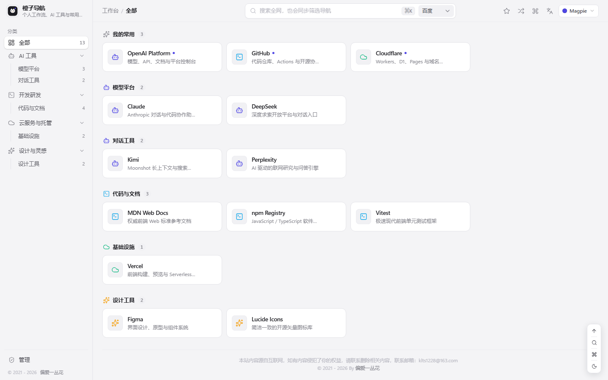

<div align="center">


# 橙子导航

### 素净、克制、打开即用的个人导航工作台。

前台快速抵达，后台随时整理，基于 Cloudflare Workers 与 D1 安静运行。

    

<br />

<picture>
  <source media="(prefers-color-scheme: dark)" srcset="docs/preview-dark.png" />
  
</picture>

</div>

<br />

## 特性

- **打开即工作台**：不设装饰性落地页，进入首页即可搜索、筛选与直达常用站点。
- **桌面级浅色与深色模式**：支持浅色、深色与跟随系统，内置 Magpie 默认平面风格与 7 种强调色微调（含自定义色），亦保留多套经典配色主题。
- **素净画布与自定义背景**：默认使用无干扰的纯色表面；后台也可切换内置插画背景或填写 HTTPS / 站内图片地址，背景层会自动叠加柔光遮罩以保证文字可读性。
- **分类与标签分组**：左侧导航用于快速定位章节与子分类，主工作区按分类与标签分块展示。
- **标签顺序与编号管理**：后台支持直接微调分类下的标签展示顺序，并可一键重排卡片序号。
- **聚合搜索与命令面板**：顶部聚合搜索同步筛选站内入口与外站检索，支持 `Ctrl + K` / `⌘ + K` 呼出命令面板，键盘上下选择直达。
- **收藏、置顶与随机**：常用入口可置顶或本地星标收藏，也支持随机打开一个可见站点。
- **桌面与移动端自适应**：从 1080p 以上五栏桌面视图到手机单栏抽屉均有独立排版，后台同样支持手机端自然滚动。
- **单密码后台与无服务器部署**：密码经 PBKDF2 哈希存入 Cloudflare Worker Secret，前后端托管在同一套 Workers + D1 服务上，push 到 `main` 后自动迁移并部署。

## 技术栈

| 模块 | 技术选型 |
| --- | --- |
| 前端 | React 19 + TypeScript 6 + Vite 8 |
| 图标 | lucide-react |
| 样式 | 原生 CSS（Magpie 风格设计令牌与响应式布局） |
| 后端 | Cloudflare Workers + Hono |
| 数据库 | Cloudflare D1 |
| 测试 | Vitest + Playwright |
| 部署 | Wrangler + GitHub Actions |

## 功能概览

### 前台导航

- **左侧分类栏**：展示全部分类与子分类计数，点击平滑定位到对应区块，保持全量内容可读。
- **顶栏工作区**：左侧显示当前位置面包屑，居中为检索框与搜索引擎菜单，右侧提供收藏筛选、随机探索、命令面板、中英切换与外观面板。
- **右下角悬浮胶囊**：一键回到顶部、聚焦搜索框、打开命令面板、快速切换浅/深色模式。

### 后台管理

访问路径：

```text
/admin
```

后台提供以下管理能力：

- **导航管理**：维护标题、网址、中英文描述、图标地址、所属分类、标签分组、排序、置顶、收藏与启用状态，支持按分类调整标签顺序与一键重排序号。
- **分类管理**：维护中英文名称、Lucide 图标选择器、强调色、排序与启用状态。
- **搜索引擎**：维护名称、快捷码、搜索 URL 模板（需包含 `{query}`）、默认项与启用状态。
- **站点设置**：配置站点标题、副标题、默认语言、默认主题、背景风格及自定义背景图地址（带实时预览）。
- **导入导出**：导出完整 JSON 配置备份，或粘贴 JSON 一键恢复与迁移。

## 快速开始

### 1. 安装依赖

```powershell
npm install
```

### 2. 生成 Cloudflare 类型

```powershell
npm run cf:types
```

### 3. 本地执行 D1 迁移

```powershell
npm run db:migrate:local
```

### 4. 启动开发服务

```powershell
npm run dev
```

默认访问地址：

```text
http://127.0.0.1:5173
```

如需本地联调 Worker API，可另开一个终端启动：

```powershell
npm run dev:worker
```

Worker 本地默认监听地址：

```text
http://127.0.0.1:8787
```

## 后台密码与 Worker Secrets

后台登录时输入的是你设定的**明文管理密码**；Cloudflare Worker 中仅保存由其派生的 PBKDF2 哈希值。

### 1. 生成密码哈希与会话密钥

```powershell
npm run secret:hash -- "你的后台管理密码"
```

输出示例：

```text
ADMIN_PASSWORD_HASH=pbkdf2_sha256$100000$...
SESSION_SECRET=...
```

### 2. 写入 Cloudflare Worker Secrets

```powershell
npx wrangler secret put ADMIN_PASSWORD_HASH
npx wrangler secret put SESSION_SECRET
```

当 Wrangler 提示 `Enter a secret value` 时，请仅粘贴等号后面的值本身。

### 3. 本地开发配置 `.dev.vars`

本地联调 Worker 时复制示例文件：

```powershell
Copy-Item .dev.vars.example .dev.vars
```

随后填入生成的两项密钥：

```text
ADMIN_PASSWORD_HASH=pbkdf2_sha256$100000$...
SESSION_SECRET=...
```

注意事项：

- 登录 `/admin` 时请输入明文管理密码。
- 请勿将明文密码或 `.dev.vars` 提交到 Git 仓库。
- 使用 `wrangler secret put` 时不要连同键名 `ADMIN_PASSWORD_HASH=` 一起粘贴。
- 不建议使用 `wrangler secret bulk .dev.vars` 批量上传，PBKDF2 哈希中的 `$` 容易被环境变量格式误解析。

## Cloudflare 部署

项目默认资源绑定（详见 [wrangler.jsonc](wrangler.jsonc)）：

- **Worker 名称**：`cyber-nav`
- **D1 数据库**：`cyber-nav-db`（绑定名 `DB`）
- **静态资源目录**：`./dist`（绑定名 `ASSETS`）

首次部署前需在远程 D1 执行一次迁移：

```powershell
npm run db:migrate:remote
```

构建并手动部署：

```powershell
npm run build
npx wrangler deploy
```

仅执行干跑校验：

```powershell
npm run deploy:dry-run
```

## GitHub Actions 自动部署

在仓库中配置以下两个 GitHub Actions Secrets：

| Secret | 用途 |
| --- | --- |
| `CLOUDFLARE_ACCOUNT_ID` | Cloudflare 账号 ID |
| `CLOUDFLARE_API_TOKEN` | 执行 Wrangler 部署与 D1 迁移 |

Cloudflare API Token 建议授予 `Workers Scripts: Edit` 与 `D1: Edit` 权限。推送代码至 `main` 分支后，工作流会自动依次执行：

1. `npm ci` 安装依赖
2. `npm run cf:types`、`npm run typecheck` 与 `npm test`
3. `npm run build` 构建前端资源
4. `wrangler d1 migrations apply cyber-nav-db --remote` 应用数据库迁移
5. `wrangler deploy` 部署 Worker 与静态资源

## 常用命令

```powershell
# 类型检查
npm run typecheck

# 代码规范检查
npm run lint

# 单元测试
npm test

# 构建生产包
npm run build

# Playwright UI 端到端测试
npm run test:ui

# 本地 / 远程 D1 迁移
npm run db:migrate:local
npm run db:migrate:remote

# Wrangler 部署干跑检查
npm run deploy:dry-run
```

## 项目结构

```text
cyber-nav/
├─ .github/workflows/      # GitHub Actions 自动部署配置
├─ docs/                   # README 预览截图
├─ migrations/             # Cloudflare D1 数据库迁移脚本
├─ public/                 # Logo 与内置背景图静态资源
├─ scripts/                # 密码哈希与背景生成工具脚本
├─ src/
│  ├─ data/                # 默认站点配置与初始导航数据
│  ├─ theme/               # Magpie 配色引擎、主题与背景定义
│  ├─ utils/               # 搜索过滤与分类分组工具函数
│  ├─ worker/              # Hono API、认证与 D1 访问层
│  ├─ App.tsx              # 前台与后台单页主界面
│  └─ index.css            # 样式令牌与响应式布局
├─ tests/                  # Vitest 与 Playwright 测试用例
├─ wrangler.jsonc          # Cloudflare Worker 配置
└─ package.json
```

## 数据与安全

- 所有导航、分类、搜索引擎与站点配置持久化在 Cloudflare D1。
- 后台采用单管理员密码机制，不引入多用户与第三方 OAuth。
- 登录态使用 `HttpOnly + Secure + SameSite=Lax` Cookie，并通过 `SESSION_SECRET` 进行 HMAC 签名。
- 登录失败尝试会记录在 D1 中用于基础限流。
- `wrangler.jsonc` 中的 `database_id` 属于资源标识而非密钥，可安全纳入版本管理；`.dev.vars`、Cloudflare API Token 与 GitHub Secrets 切勿提交。

<br />

<div align="center">
  <sub>© 2021 - 2026 <a href="https://www.nerocats.com/">偏爱一丛花</a></sub>
</div>
